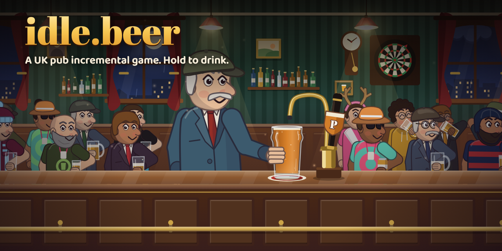
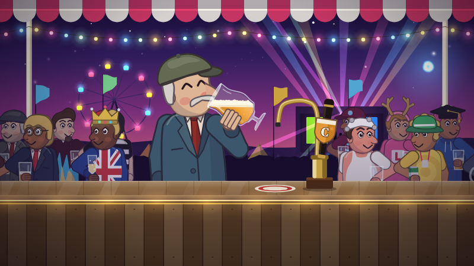
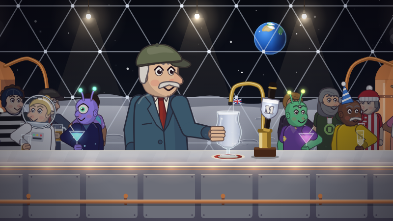
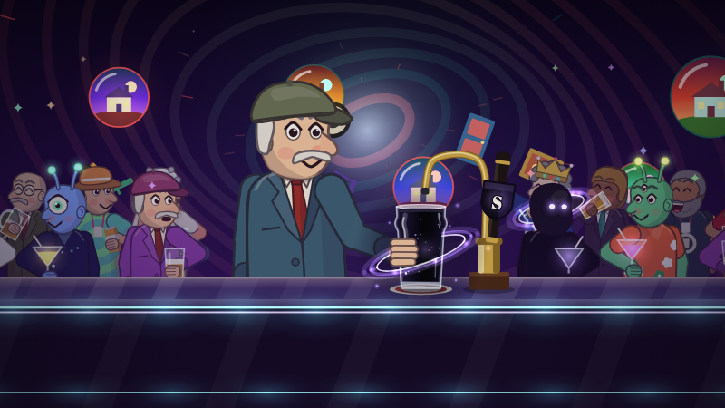

# idle.beer



A UK pub incremental game. You start as one person in a pub with one pint. Hold to drink it.
Pints are the currency: spend them on better beers, more drinkers, upgrades and new pubs, until
you are running a lock-in that spans the multiverse.

Built with TypeScript and Vite, with no framework and no image assets: every character, pint and
pub is drawn in code on a single canvas.

## What's in it

- **Hold to drink.** Click, touch or hold Space to lift the glass. Let go and it goes back down
  part-drunk; keep holding and the next pint starts by itself. Back-to-back pints build a chug streak.
- **18 kinds of drinker**, from The Regular to the Multiverse Lock-In, each drinking for you all day.
- **Beers that never run out.** 31 hand-written beers, then generated ones forever, each with its
  own colour, glass and effect.
- **12 pubs to open and choose between**, each with a perk of its own.
- **Around 250 upgrades and 160 achievements.**
- **Free Rounds:** a golden pint drifts through the pub every few minutes. Catch it.
- **Last Orders:** ring the bell to start again with Beer Mats, which boost everything and buy
  permanent Landlord's Licences.
- **Numbers that go a long way.** Everything runs on
  [break_infinity.js](https://github.com/Patashu/break_infinity.js), so it keeps working far past
  where ordinary JavaScript numbers give up.
- **Saves itself** in your browser, with export and import, and credits your drinkers for time away.

<table>
  <tr>
    <td></td>
    <td></td>
    <td></td>
  </tr>
</table>

## Running it

You need a recent [Node.js](https://nodejs.org) (22 or newer).

```bash
npm install
npm run dev
```

Then open the address it prints. Add `?debug` to the URL for a panel that hands out pints, cycles
beers and moves pub.

| Command | What it does |
|---------|--------------|
| `npm run dev` | Dev server |
| `npm test` | Unit tests, including stress tests at huge numbers |
| `npm run build` | Type-check and production build into `dist/` |
| `npm run simulate -- [activity] [target] [runs]` | Plays the game with a bot to check pacing |

Two pages on the dev server are for working on the art: `/sheet.html` shows every character
large, and `/banner.html` renders the scene without the HUD (the images in this README come from it).

## How it's put together

| Folder | What's there |
|--------|--------------|
| `src/core` | The game: economy, drinking, events, prestige, saving |
| `src/data` | Content as data: drinkers, beers, upgrades, pubs, achievements, the Licence |
| `src/ui` | The shop, dialogs and HUD |
| `src/ui/art` | The scene: characters, pints, pubs and the canvas that draws them |
| `tests` | Unit tests |
| `tools` | The pacing simulator |

[DESIGN.md](DESIGN.md) has the full design: the numbers, the formulas, and how the scene is drawn.

## Credits

Made by [wrux.com](https://wrux.com). Say hello on Instagram:
[@etocallum](https://www.instagram.com/etocallum).
